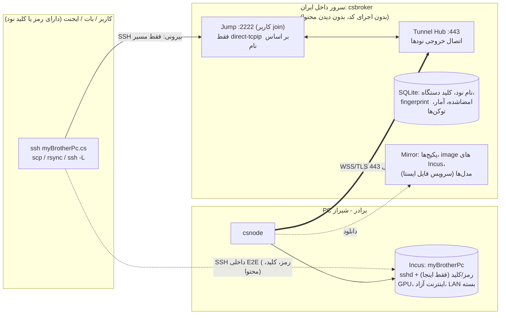

# پیشنهاد نسخه ۳: شبکهٔ اشتراک فضای لینوکسی ایزوله (Incus + رلهٔ SSH سرتاسری)

> نسخه: `v3` · تاریخ: 2026-10-16 · بر اساس پاسخ‌های alishafiee1 به سؤال‌های v2
> `PROPOSAL_v2.md` و `SPEC.md` برای سابقه می‌مونن.
> اسم موقت: `ComputeShare` · کامند‌ها: `csnode` (روی نود)، `csbroker` (روی سرور)، `cs` (CLI اختیاری کاربر)
> 💡 = پیشنهاد من

---

## ۰. تغییرات نسبت به v2
| موضوع | v2 | v3 |
|---|---|---|
| کنترل دسترسی | ACL و گروه روی سرور | **حذف شد.** هر کی username و رمز یا کلید نود رو داشته باشه وارد می‌شه. توکن شبکه فقط برای عضو شدن سیستم‌هاست |
| رمزنگاری | حالت ۱ (MITM) پیش‌فرض، حالت ۲ اختیاری | **فقط سرتاسری (E2E).** سرور فقط بایت رمزشده رله می‌کنه و هیچ رمز، کلید یا محتوایی نمی‌بینه |
| اعتبارنامه‌ها | بخشی روی سرور (hash رمز) | **فقط روی نود** |
| سرور | داخل یا خارج | **داخل ایران** |
| اینترنت فضا | سؤال باز | **آزاد**، ولی LAN و میزبان بسته؛ محدودیت پهنای باند و کلید اضطراری دست صاحب نود |
| instance جدا برای هر کاربر | پیشنهاد | فقط ایدهٔ آینده |

---

## ۱. خلاصه
- صاحب سیستم `csnode` رو نصب می‌کنه. روی سیستمش یه **لینوکس ایزوله با Incus** ساخته می‌شه و **خودش** username یکتا (مثلاً `myBrotherPc`) و رمز یا کلید SSH رو تعیین می‌کنه. این اطلاعات **فقط روی نود** ذخیره می‌شه.
- `csnode` با **توکن شبکه** به سرور داخل ایران **وصل می‌شه (خروجی روی 443)**. سرور یکتایی نام رو چک می‌کنه و نود عضو می‌شه. نود به IP ثابت نیازی نداره.
- سرور (`csbroker`) **هیچ کدی اجرا نمی‌کنه و هیچ چیزی رو باز نمی‌کنه.** فقط اتصال‌ها رو مدیریت و بایت‌های رمزشده رو رله می‌کنه.
- هر کسی که صاحب نود رمز یا کلید رو بهش داده، با SSH استاندارد وارد می‌شه:
  - `ssh myBrotherPc.cs` (بعد از یک خط تنظیم)
  - یا `cs ssh myBrotherPc`
  - یا `ssh -J join@node.n3xus.ir:2222 user@myBrotherPc`
  - یا با پورت اختصاصی نود: `ssh -p 40123 user@node.n3xus.ir`
- `ssh list@node.n3xus.ir` (یا `cs nodes`) لیست نودها رو با مشخصات، بار فعلی و میانگین نشون می‌ده.

---

## ۲. Incus در برابر Docker (خلاصه)
- **Docker** = اجرای «یک برنامه». **Incus** = «یه کامپیوتر لینوکسی کامل»، با `systemd`، کاربر، رمز، `sshd` و `apt`.
- Incus دو حالت داره: **کانتینر unprivileged** (سبک؛ root داخلش روی میزبان بی‌قدرته) و **VM** (ایزوله‌تر، سنگین‌تر).
- محدودیت منابع: `limits.cpu`، `limits.memory`، سهمیهٔ دیسک، `limits.ingress/egress` برای پهنای باند، و GPU با device `gpu`.
- برای «ورود با SSH و انجام هر کاری»، Incus انتخاب درستیه. داخل فضا هر چیزی (Docker، Ollama، Python) قابل نصبه.
- منبع: https://linuxcontainers.org/incus/docs/main/

## ۳. Windows (بدون تغییر نسبت به v2)
- دیمون Incus فقط روی Linux اجرا می‌شه؛ Windows فقط کلاینت داره (https://linuxcontainers.org/incus/docs/main/installing/).
- **راه‌حل:** `csnode-setup.exe` یه توزیع اختصاصی WSL2 بالا میاره، `systemd` رو فعال می‌کنه (https://learn.microsoft.com/en-us/windows/wsl/systemd)، Incus رو نصب می‌کنه و یه کانتینر unprivileged با username و رمز صاحب نود می‌سازه.
- محدودیت: VM داخل Incus روی WSL2 کار نمی‌کنه، چون کرنل WSL ماژول `vhost_vsock` نداره (https://github.com/microsoft/WSL/discussions/11167). پس روی Windows فقط حالت کانتینر هست.
- GPU NVIDIA: CUDA در WSL2 کار می‌کنه، ولی عبورش به کانتینر Incus باید در فاز ۴ با تست واقعی اثبات بشه.
- Hyper-V یا VirtualBox فقط به‌عنوان جایگزین مطرحه، چون عملاً GPU ندارن و Windows Home اصلاً Hyper-V نداره.

---

## ۴. رمزنگاری سرتاسری: آیا `ssh myBrotherPc@node.n3xus.ir` می‌تونه E2E باشه؟
**نه، با SSH استاندارد نمی‌شه.** در SSH، نام کاربری **بعد از** برقراری رمزنگاری و داخل کانال رمزشده فرستاده می‌شه. سروری که بخواد از روی `myBrotherPc@` بفهمه کجا بفرسته، باید خودش طرف رمزنگاری باشه، یعنی محتوا رو ببینه. SSH چیزی مثل SNI در HTTPS نداره که مقصد قبل از رمزنگاری معلوم باشه.

**راه‌حل انتخابی:** نام مقصد رو در لایهٔ **بیرونی** به سرور می‌دیم و اتصال SSH اصلی رو **داخل** اون، مستقیم با `sshd` خود نود برقرار می‌کنیم. این همون `ProxyJump` استاندارد OpenSSH است:

```
کاربر ──SSH بیرونی (فقط مسیریابی)──▶ csbroker ──تونل نود──▶ csnode ──▶ sshd داخل Incus
       └──────────── SSH داخلی رمزشدهٔ سرتاسری: کاربر ⇄ sshd نود ────────────┘
```
- SSH بیرونی با کاربر عمومی `join` انجام می‌شه. احرازش چیز محرمانه‌ای نیست: بدون رمز (`none`) با rate limit، یا 💡 یه کلید ساده برای ضد سوءاستفاده.
- کاربر داخل SSH بیرونی فقط درخواست `direct-tcpip` به `myBrotherPc:22` می‌ده. `csbroker` این اسم رو به تونل اون نود وصل می‌کنه و فقط بایت جابه‌جا می‌کنه.
- **رمز، کلید و محتوا فقط بین کاربر و نود ردوبدل می‌شن.** سرور نه shell داره، نه رمز می‌بینه، نه محتوا.

### راه‌های استفاده (از ساده به حرفه‌ای)
| راه | کامند | کجا مناسبه |
|---|---|---|
| **A. یک خط تنظیم (پیشنهاد اصلی)** | یه بار: `cs setup-ssh` (یا دستی، بلوک پایین) · بعد: `ssh myBrotherPc.cs` · `scp f myBrotherPc.cs:` · Cursor Remote-SSH: `myBrotherPc.cs` | آدم‌ها، Cursor/VS Code، ایجنت‌هایی که `~/.ssh/config` می‌خونن |
| **B. بدون هیچ تنظیمی** | `ssh -J join@node.n3xus.ir:2222 user@myBrotherPc` | یه بار مصرف، سیستم غریبه |
| **C. CLI** | `cs ssh myBrotherPc` · `cs scp ...` | کسی که `cs` نصب کرده؛ host key هم خودکار چک می‌شه |
| **D. ProxyCommand برای کتابخانه‌ها** | `ProxyCommand ssh -p 2222 -W %h:22 join@SERVER` یا `cs proxy %h` | `paramiko` (`ProxyCommand`)، `asyncssh` (`tunnel=`) در بات‌ها |
| **E. پورت اختصاصی (از اول فعال)** | `ssh -p 40123 user@node.n3xus.ir` | نزدیک‌ترین تجربه به `ssh user@server` بدون هیچ تنظیمی؛ برای ابزارهایی که Jump یا config رو پشتیبانی نمی‌کنن. **همچنان E2E** است چون سرور فقط بایت‌های TCP اون پورت رو به تونل نود فوروارد می‌کنه و SSH مستقیم با `sshd` نود برقرار می‌شه. هر نود موقع ثبت‌نام یه پورت ثابت از رنج `40000-40199` (۲۰۰ نود، قابل تنظیم با `port_range`؛ این بازه از پورت‌های موقت لینوکس رزرو می‌شه) می‌گیره که در `ssh list@` نمایش داده می‌شه |

بلوک `~/.ssh/config` (همونی که `cs setup-ssh` می‌نویسه):
```sshconfig
Host *.cs
  ProxyCommand ssh -p 2222 -W %n:22 join@node.n3xus.ir   # %n = نام کامل مثل myBrotherPc.cs؛ broker پسوند .cs رو حذف می‌کنه
  User user          # کاربر معمولی با sudo؛ نامش رو صاحب نود تعیین می‌کنه
  UserKnownHostsFile ~/.ssh/cs_known_hosts
  StrictHostKeyChecking yes
```

### تأیید هویت نود (Host key pinning)
مشکل: اگه سرور خراب یا هک بشه، می‌تونه کاربر رو به یه نود تقلبی بفرسته. راه‌حل:
1. موقع نصب، `csnode` کلید میزبان SSH فضا (`ssh_host_ed25519_key.pub`) رو با **کلید دستگاه نود** امضا می‌کنه و در ثبت‌نام به سرور می‌ده.
2. سرور fingerprintها رو منتشر می‌کنه: `ssh list@SERVER known_hosts` یا `cs known-hosts`. نتیجه در `~/.ssh/cs_known_hosts` نوشته می‌شه و SSH اگه نود عوض شده باشه، **اتصال رو رد می‌کنه**.
3. چون سرور خودش هم می‌تونه دروغ بگه، **صاحب نود fingerprint کوتاه رو همراه رمز به کاربر می‌ده**. `csnode status` نشونش می‌ده؛ مثلاً `SHA256:Xk3…9Qa`.
   - `cs` موقع اولین اتصال می‌پرسه «این fingerprint با چیزی که صاحب نود داده یکیه؟»
   - 💡 گزینهٔ امن‌تر: کاربر fingerprint رو مستقیم با `cs trust myBrotherPc SHA256:...` ثبت کنه.
4. نتیجه: حتی اگه سرور دست کس دیگه‌ای بیفته، محتوا و رمزها لو نمی‌رن. اتصال قطع می‌شه، ولی دزدیده نمی‌شه.

---

## ۵. کنترل دسترسی (ساده)
- **توکن شبکه:** فقط اجازهٔ **عضو شدن یک سیستم** رو می‌ده. ادمین شبکه می‌سازه و می‌تونه revoke کنه.
- **دسترسی به هر نود:** فقط با **username + رمز یا کلید SSH** که صاحب نود تعیین کرده و خودش به هر کسی بخواد می‌ده.
  - سرور هیچ لیست دسترسی‌ای نگه نمی‌داره.
  - صاحب نود برای قطع دسترسی کسی، رمز رو عوض می‌کنه یا کلید رو از `authorized_keys` برمی‌داره (`csnode keys remove`).
- **تأیید اتصال توسط صاحب نود (اختیاری):** پیش‌فرض خاموشه، یعنی هر کی رمز یا کلید معتبر داره مستقیم وصل می‌شه. صاحب نود موقع نصب یا بعداً با `csnode config approval on` روشنش می‌کنه:
  - **کلید جدید:** `sshd` داخل فضا کلیدها رو از `csnode` می‌پرسه (`AuthorizedKeysCommand`). کلیدی که قبلاً تأیید نشده، در صف `pending` می‌ره و اتصال رد می‌شه با پیام «منتظر تأیید صاحب نود». صاحب نود `csnode pending` رو می‌بینه (fingerprint کلید، زمان، IP مبدأ که broker در متادیتا می‌فرسته) و با `csnode approve <id>` دائمی تأیید می‌کنه. اتصال بعدی مستقیم برقراره.
  - **ورود با رمز:** چون کلیدی نیست، `csnode` خود stream ورودی رو قبل از رسیدن به `sshd` تا ۶۰ ثانیه نگه می‌داره تا صاحب نود `csnode approve <id> --once` (فقط همین نشست) یا بدون `--once` (این IP مبدأ برای ۲۴ ساعت) بزنه.
  - این تأیید **کاملاً روی نود** انجام می‌شه؛ سرور نه کلید رو می‌بینه نه تصمیم می‌گیره، پس E2E حفظ می‌شه. 💡 اعلان روی دسکتاپ (یا آیکون tray در Windows) برای درخواست جدید.
- 💡 صاحب نود می‌تونه چند کلید با اسم داشته باشه (`csnode keys add my-bot ...`) تا دسترسی هر نفر رو جدا قطع کنه.
- (ایدهٔ آینده: کاربرهای جدا یا instance جدا برای هر نفر روی یک نود.)

---

## ۶. معماری



---

## ۷. اجزا
### `csnode` (روی هر نود، Go)
- نصب و تنظیم Incus (روی Windows داخل WSL2).
- ساخت instance با username، رمز یا کلید، `sshd` و محدودیت‌ها.
- ثبت‌نام با توکن شبکه، و تونل خروجی دائمی (WebSocket روی TLS 443 + `yamux`).
- هر stream ورودی **فقط** به `instance:22` وصل می‌شه.
- ارسال heartbeat و آمار. مدیریت `keys`، `pause`، `stop` و `bandwidth`.

### `csbroker` (روی سرور، یک باینری Go یا یک image کانتینر، هر توزیع Linux)
- Jump SSH با کاربر `join`: shell، exec و subsystem همه رد می‌شن و فقط `direct-tcpip` به `<name>:22` قبول می‌شه.
- Tunnel Hub، ثبت‌نام، یکتایی نام، توکن‌ها، انتشار fingerprintها، آمار.
- `ssh list@` که فقط متن جدول برمی‌گردونه (کد کاربر رو اجرا نمی‌کنه).
- پورت اختصاصی هر نود (راه E): listener TCP ساده روی سرور که فقط بایت‌ها رو به تونل نود می‌فرسته؛ بدون باز کردن SSH.
- 💡 mirror فایل ایستا (یا Nginx کنارش).
- Audit فقط متادیتا: نام نود، زمان شروع و پایان، حجم بایت، IP مبدأ.

### `cs` (اختیاری، Go)
- `cs nodes`، `cs ssh`، `cs scp`، `cs setup-ssh`، `cs known-hosts`، `cs trust`، `cs proxy`.

---

## ۸. جریان‌ها
### ۸.۱ نصب (صاحب نود)
1. نصاب از **سرور شبکه (داخل ایران)** دانلود می‌شه:
   - Linux: `curl -fsSL https://SERVER/install.sh | sudo sh`
   - Windows: `csnode-setup.exe`
2. Incus از **mirror داخلی** نصب می‌شه.
3. منابع نمایش داده می‌شن و صاحب نود سقف‌ها رو انتخاب می‌کنه: CPU، RAM، دیسک، GPU، **پهنای باند** و **سقف حجم**. نصاب مقدار پیشنهادی نشون می‌ده؛ **اگه خالی بمونه، نامحدوده** (بخش «تصمیم‌های نهایی»).
4. صاحب نود وارد می‌کنه:
   - **username یکتا** (`myBrotherPc`)؛ همون لحظه با سرور چک می‌شه
   - **نام کاربر لینوکسی فضا** (پیش‌فرض `user`)؛ یه کاربر معمولی عضو `sudo`. ورود مستقیم `root` با SSH بسته‌ست (`PermitRootLogin no`)
   - **رمز** و/یا **کلید عمومی SSH**؛ فقط روی نود ذخیره می‌شه
   - آدرس سرور
   - توکن شبکه
5. instance ساخته می‌شه:
   - `images:debian/12` از mirror داخلی
   - `security.privileged=false`
   - limits
   - `sshd` با `PasswordAuthentication` به انتخاب صاحب نود
6. رضایت‌نامه نمایش داده می‌شه (اینترنت آزاده، کلید اضطراری کجاست) و صاحب نود `yes` تایپ می‌کنه.
7. `csnode status` fingerprint رو نشون می‌ده تا صاحب نود همراه رمز به بقیه بده.

### ۸.۲ ثبت‌نام
1. `csnode` کلید دستگاه `Ed25519` می‌سازه و به سرور می‌فرسته: نام، توکن، کلید عمومی دستگاه، **host key امضاشدهٔ فضا**، مشخصات.
2. سرور توکن رو چک می‌کنه، نام رو **رزرو** می‌کنه (تکراری بود رد می‌شه)، و نود `online` می‌شه.
   - عضویت در شبکه با توکن معتبر **خودکاره** (بدون تأیید ادمین؛ ادمین فقط می‌تونه ban کنه). نود یه پورت ثابت (راه E) هم می‌گیره.
3. نام به کلید دستگاه گره می‌خوره. فقط همون دستگاه (یا `csnode leave`) می‌تونه آزادش کنه، پس کسی نمی‌تونه نام رو بدزده.

### ۸.۳ اتصال E2E
1. `ssh myBrotherPc.cs` ← SSH بیرونی به `join@SERVER` ← درخواست `direct-tcpip myBrotherPc:22`.
2. `csbroker` تونل نود رو پیدا می‌کنه و یه stream باز می‌کنه ← `csnode` ← `instance:22`.
3. SSH داخلی: host key با `cs_known_hosts` چک می‌شه، و رمز یا کلید مستقیم با `sshd` نود.
4. نود آفلاین بود ← پیام `myBrotherPc is offline (last seen 12m)`.

### ۸.۴ لیست و آمار
```
$ ssh list@node.n3xus.ir      # یا cs nodes / --json
NAME         STATUS   CPU    RAM    GPU           LOAD now/avg24h  NET-LIMIT  UPTIME
myBrotherPc  online   8c     16GB   RTX4070 12GB  23% / 41%        20 Mbit    3d
myPc         online   4c     8GB    -             5% / 12%         10 Mbit    6h
```
فقط اطلاعات عمومی؛ هیچ اطلاعات ورود اینجا نیست.

### ۸.۵ توقف و خروج
| کامند | نتیجه |
|---|---|
| `csnode pause` / `resume` | اتصال جدید قبول نمی‌شه |
| `csnode stop` | کلید اضطراری: instance و تونل فوراً قطع می‌شن (بدون نیاز به سرور) |
| `csnode keys add/remove`، `csnode passwd` | مدیریت دسترسی |
| `csnode bandwidth 20Mbit` · `csnode bandwidth off` | محدودیت اینترنت فضا (`off` = نامحدود) |
| `csnode quota 20GB/day` · `csnode quota off` | سقف حجم |
| `csnode config approval on\|off` | روشن یا خاموش کردن تأیید اتصال (بخش ۵) |
| `csnode pending` · `csnode approve <id> [--once]` · `csnode deny <id>` | دیدن و تأیید درخواست‌های اتصال در انتظار |
| `csnode who` | نشست‌های فعال روی فضای خودش |
| `csnode leave --purge` | حذف کامل و آزاد شدن نام |
| ادمین شبکه: `csbroker token revoke`، `csbroker node ban <name>` | قطع عضویت نود متخلف |

---

## ۹. سناریوی برادر (سرتاسر)
1. برادرت در شیراز `csnode` رو نصب می‌کنه، نام `myBrotherPc` و رمز رو تعیین می‌کنه، GPU رو مجاز می‌کنه، پهنای باند پیشنهادی `20Mbit` رو قبول می‌کنه و سقف حجم رو خالی می‌ذاره (نامحدود)، و رمز + fingerprint رو برای تو می‌فرسته. 💡 بهتره کلید عمومی SSH بات و سیستمت رو بهش بدی تا `csnode keys add` کنه.
2. روی PC خودت: `cs setup-ssh` و `cs trust myBrotherPc SHA256:...`.
3. یه بار راه‌اندازی:
   ```bash
   ssh myBrotherPc.cs
   curl -fsSL https://SERVER/mirror/ollama/install.sh | sh
   ollama pull hermes3:8b          # یا از mirror مدل داخلی (بخش ۱۱)
   ```
4. **بات Telegram/Bale روی PC تو** (Python + `asyncssh` از طریق `tunnel=` یا `ProxyCommand`):
   - آنلاین بودن رو چک می‌کنه: `ssh list@SERVER json`
   - فایل کاربر (متن، تصویر یا صدا) رو می‌فرسته: `scp voice.ogg myBrotherPc.cs:/work/in/` (یا `rsync -z`)
   - پردازش رو اجرا می‌کنه: `ssh myBrotherPc.cs 'whisper /work/in/voice.ogg -o /work/out'`
   - نتیجه رو برمی‌گردونه: `scp myBrotherPc.cs:/work/out/voice.txt .` و به کاربر بات جواب می‌ده
   - نود آفلاین بود: پیام «پردازشگر خاموشه» یا 💡 صف تا آنلاین شدن
5. **API مدل از طریق تونل رمزشده:**
   ```bash
   ssh -N -L 11434:localhost:11434 myBrotherPc.cs
   curl http://localhost:11434/v1/chat/completions -d '{"model":"hermes3:8b","messages":[...]}'
   ```
   هر SDK سازگار با OpenAI با `base_url=http://localhost:11434/v1` کار می‌کنه. سرور فقط بایت رمزشده می‌بینه.
6. **Cursor، Claude و Grok Bot:** با `ssh myBrotherPc.cs` یا Remote-SSH (`myBrotherPc.cs`) وارد می‌شن. ابزاری که config نمی‌خونه از راه B یا E استفاده می‌کنه.

---

## ۱۰. امنیت
| لایه | کار |
|---|---|
| محرمانگی | **E2E همیشه.** سرور هرگز رمز، کلید، دستور یا فایل نمی‌بینه؛ فقط متادیتا (کی به کدوم نود، چقدر بایت) |
| هویت نود | host key امضاشده با کلید دستگاه + fingerprint از طرف صاحب نود + `StrictHostKeyChecking yes` |
| سرور | بدون اجرای کد؛ کاربر `join` هیچ shell یا exec نداره؛ کاربرهای شبکه حساب سیستمی ندارن؛ پورت ادمین جدا |
| ایزولهٔ نود | Incus unprivileged (یا VM روی Linux)؛ بدون mount پوشه‌های میزبان |
| شبکهٔ فضا | **اینترنت آزاد**؛ ولی دسترسی به LAN (`10/8`، `172.16/12`، `192.168/16`، `169.254/16`) و IP میزبان با Incus network ACL / nftables بسته‌ست |
| منابع | `limits.cpu/memory/processes`، سهمیهٔ دیسک، **`limits.ingress/egress`** |
| نام‌ها | یکتا و گره‌خورده به کلید دستگاه؛ بدون امکان جعل |
| ضد حمله به سرور | rate limit اتصال‌های `join` بر اساس IP؛ محدودیت تعداد stream همزمان برای هر IP؛ سقف اتصال برای هر نود |
| ضد حدس رمز روی نود | 💡 `csnode` به‌صورت پیش‌فرض `fail2ban`‌مانند داخل فضا فعال می‌کنه (قفل بعد از ۵ تلاش). ⚠️ چون همهٔ اتصال‌ها از تونل میان، IP واقعی کاربر رو `csbroker` در متادیتای stream می‌فرسته |
| توصیه | 💡 کلید SSH به‌جای رمز؛ رمز حداقل ۱۲ کاراکتر (نصاب اجبار کنه) |

### ریسک اینترنت آزاد
فضا با **IP اینترنت صاحب نود** به اینترنت می‌ره. اگه کسی که رمز رو داره سوءاستفاده کنه (اسپم، اسکن، دانلود غیرقانونی، ماینینگ)، مسئولیت و مصرف حجم پای صاحب نوده. کاهش ریسک:
- محدودیت پهنای باند به انتخاب صاحب نود (پیشنهاد نصاب `20Mbit`؛ خالی = نامحدود)
- سقف حجم روزانه (`csnode quota 20GB/day`، پیشنهاد نصاب؛ خالی = نامحدود) با قطع خودکار اینترنت فضا تا روز بعد
- 💡 بستن پورت‌های پرخطر خروجی به‌صورت پیش‌فرض (SMTP 25)
- `csnode who` و `csnode stop` همیشه دست صاحب نوده
- رمز فقط به آدم‌های مورد اعتماد داده بشه (چون ACL سروری نداریم، اعتماد = داشتن رمز)

---

## ۱۱. شبکه با سرور داخل ایران
- **میزبانی داخلی** (دیتاسنترهای داخلی) با IP و ترجیحاً دامنهٔ `.ir`؛ ترافیک نودها داخلی می‌مونه و در قطعی اینترنت بین‌الملل هم کار می‌کنه.
- **نودها فقط خروجی روی 443** با TLS، که با NAT، CGNAT اپراتور موبایل، و فایروال سازگاره.
- **کاربرها:** SSH بیرونی به پورت `2222` سرور (پورت `22` دست `sshd` خود سروره و csbroker نمی‌تونه روش باشه). پورت‌های نودها `40000-40199` با `ip_local_reserved_ports` رزرو می‌شن. API ثبت‌نام روی `127.0.0.1:8088` و از طریق nginx روی ساب‌دامین `https://node.n3xus.ir` منتشر می‌شه (تصمیم ۲۰۲۶-۱۰-۱۶).
- **Mirror داخلی روی همون سرور (یا سرور کنارش)**، چون اینترنت بین‌الملل نودها ممکنه فیلتر یا کند باشه:
  - پکیج‌های Incus (Zabbly) و Debian/Ubuntu (`apt-cacher-ng` یا mirror کامل)
  - imageهای Incus (`simplestreams` محلی)
  - فایل‌های مدل (GGUF و …)
  - نصاب‌های رایج (Ollama، Python wheels با `devpi`/mirror pip، npm)
  - 💡 imageهای Docker (`registry:2` proxy)
  - mirror فقط فایل ایستا سرو می‌کنه؛ اجرای کد روی سرور نیست
  - 💡 استفاده از mirrorهای داخلی موجود هم ممکنه، قابل تنظیم در `csnode`
- **پهنای باند بین‌الملل** گرون و محدوده. پر کردن mirror یه بار از خارج انجام می‌شه (مثلاً مدل‌های چند گیگی) و بعد نودها فقط از داخل دانلود می‌کنن.
- **ترافیک SSH:** چون همهٔ ترافیک کاربرها از سرور رد می‌شه، پهنای باند سرور مهمه (مثلاً انتقال فایل‌های حجیم). 💡 سقف پهنای باند برای هر stream روی سرور.
- **اینترنت آزاد داخل فضا** از اینترنت خود صاحب نود می‌ره، پس همون محدودیت‌های فیلترینگ اینترنت اون رو داره.
- reconnect خودکار با backoff؛ heartbeat سبک.

---

## ۱۲. نرم‌افزارهای مشابه (از v2، خلاصه)
هیچ پروژه‌ای همهٔ موارد رو نداره: E2E + مسیریابی بر اساس نام + تونل معکوس + Incus.
- **sshpiper** (https://github.com/tg123/sshpiper): مسیریابی با username **با MITM**. با شرط E2E دیگه مناسب نیست، فقط مرجع کد.
- **Teleport** (https://github.com/gravitational/teleport): نزدیک‌ترین طراحی (reverse tunnel + جامپ)، ولی سنگین، با کلاینت خاص، و سرور در محتوا دخیله.
- **OpenRport** (https://github.com/openrport/openrport): تونل معکوس با پورت جدا. مدل راه E ما.
- **chisel** (https://github.com/jpillora/chisel) / **rathole** (https://github.com/rapiz1/rathole) / **frp** (https://github.com/fatedier/frp): لایهٔ تونل. برای MVP سریع قابل استفاده‌ان.
- **راه سریع MVP:** خود OpenSSH روی سرور با یه کاربر `join` محدود (`ForceCommand`/`PermitOpen` و `AllowTcpForwarding local`) + `ssh -R` از نود به unix socket. ⚠️ ولی «بدون اجرای کد روی سرور» با `sshd` سیستمی سخت‌تر تضمین می‌شه، پس **پیشنهاد نهایی:** `csbroker` با `golang.org/x/crypto/ssh` که اصلاً shell نداره.

---

## ۱۳. فناوری
| بخش | انتخاب |
|---|---|
| `csnode`، `csbroker`، `cs` | **Go**: `x/crypto/ssh`، `yamux`، `gorilla/websocket`، کلاینت رسمی Incus (`github.com/lxc/incus/client`) |
| DB سرور | SQLite |
| استقرار سرور | یک باینری + `systemd` (نه Docker: پورت‌های `-p` داکر از ufw رد می‌شن). آینه روی یک LV جدای ۴۰ گیگی `/srv/mirror`. راهنما: `computeshare-broker/docs/DEPLOY.md` |
| Mirror | Nginx ایستا + `apt-cacher-ng` + simplestreams |
| Windows | نصاب `Inno Setup`/`WiX` + اسکریپت WSL2 + سرویس |
| بات | Python `asyncssh` (پشتیبانی جامپ با `tunnel=`) |

---

## ۱۴. فازهای MVP
| فاز | خروجی | معیار پذیرش |
|---|---|---|
| **۱ (۱ هفته)** | `csnode` روی Linux: Incus، instance، username و رمز یا کلید، limits، ACL شبکه | از داخل فضا اینترنت هست ولی `ping 192.168.1.1` و IP میزبان جواب نمی‌دن؛ سقف‌ها در `incus config show` دیده می‌شن |
| **۲ (۱–۲ هفته)** | `csbroker`: Hub تونل + ثبت‌نام خودکار با توکن + یکتایی نام + Jump با `direct-tcpip` + **پورت اختصاصی هر نود** | `ssh -J join@SERVER:2222 user@myBrotherPc` و `ssh -p <port> user@SERVER` از سیستم سوم به نود پشت NAT وصل می‌شه؛ **در capture ترافیک و لاگ سرور هیچ رمز یا محتوایی دیده نمی‌شه**؛ `ssh join@SERVER` هیچ shell‌ای نمی‌ده؛ نام تکراری رد می‌شه |
| **۳ (۱ هفته)** | host key امضاشده + `cs known-hosts/trust/setup-ssh/ssh`، و `ssh list@` با آمار | نود جعلی با همون نام رد می‌شه (`REMOTE HOST IDENTIFICATION`)؛ `ssh myBrotherPc.cs`، `scp` و `ssh -L` کار می‌کنن؛ لیست بار فعلی و میانگین داره |
| **۴ (۱–۲ هفته)** | Windows: `csnode-setup.exe` + WSL2 + Incus + GPU | روی Windows 11 فضای لینوکسی بالا میاد؛ `nvidia-smi` داخلش (در صورت موفقیت تست GPU) |
| **۵ (۱ هفته)** | Mirror داخلی + نصب آفلاین؛ پهنای باند و quota؛ `stop/who/keys`؛ rate limit؛ **تأیید اتصال توسط صاحب نود** (`csnode config approval`) | نصب کامل بدون اینترنت بین‌الملل؛ عبور از quota ← قطع خودکار اینترنت فضا؛ مقدار خالی ← بدون محدودیت؛ با `approval on`، کلید ناشناس تا `csnode approve` وصل نمی‌شه |
| **۶** | بات نمونهٔ Telegram/Bale، داشبورد وب (فقط وضعیت)، به‌روزرسانی امضاشده | سناریوی برادر سرتاسر کار می‌کنه |

---

## ۱۵. ریسک‌ها
- **اعتماد = رمز:** هر کی رمز رو داره همه کار می‌کنه. اگه رمز لو بره، صاحب نود باید عوضش کنه. کلید SSH و چند کلید جدا پیشنهاد می‌شه.
- **سوءاستفاده از اینترنت آزاد** با IP صاحب نود (بخش ۱۰).
- **حدس رمز** از طریق جامپ عمومی: rate limit سرور + قفل روی نود.
- **تجربهٔ کاربری E2E** یه قدم بیشتر از `ssh user@server` داره (یک خط config یا `cs`)؛ ابزارهای قدیمی راه E (پورت اختصاصی) رو دارن.
- **پهنای باند سرور داخلی** برای انتقال‌های حجیم.
- **Windows/WSL2:** GPU داخل Incus اثبات‌نشده، VM ممکن نیست، و تداخل iptables با Docker Desktop.
- **مسئولیت حقوقی** صاحب نود و ادمین شبکه.

## ۱۶. تصمیم‌های نهایی (alishafiee1، 2026-10-16)
1. **عضویت در شبکه:** نود با توکن معتبر **خودکار** وصل می‌شه (ادمین فقط امکان ban داره). **تأیید اتصال به هر نود** دست صاحب همون نوده: پیش‌فرض خاموش؛ با `csnode config approval on` موقع نصب یا بعداً روشن می‌شه و هر کلید یا نشست جدید باید با `csnode approve` تأیید بشه (بخش ۵).
2. **پورت اختصاصی هر نود از اول فعاله** (`ssh -p 40123 user@SERVER`)، کنار ProxyJump؛ هر دو E2E.
3. **پهنای باند و سقف حجم:** نصاب مقدار پیشنهادی نشون می‌ده؛ **خالی = نامحدود**. مقادیر پیشنهادی:
   - پهنای باند اینترنت فضا: `20Mbit` (هم دانلود هم آپلود)
   - سقف حجم: `20GB/day`
   - بعداً با `csnode bandwidth …|off` و `csnode quota …|off` قابل تغییره
4. **کاربر پیش‌فرض:** یه کاربر معمولی با `sudo` (پیش‌فرض نامش `user`، قابل تغییر توسط صاحب نود)؛ `root` با SSH وارد نمی‌شه.

سؤال باز اساسی دیگه‌ای نمونده.

## ۱۷. ایده‌های آینده
- چند کاربر یا instance جدا روی یک نود؛ اشتراک‌گذاری دسترسی موقت (رمز یک‌بارمصرف)
- صف کار برای نود آفلاین؛ قالب‌های آماده (`ollama-gpu`، `whisper`)
- داشبورد وب و اتصال به RODO board؛ کلید جدا برای هر بات
- حالت VM برای نودهای Linux
